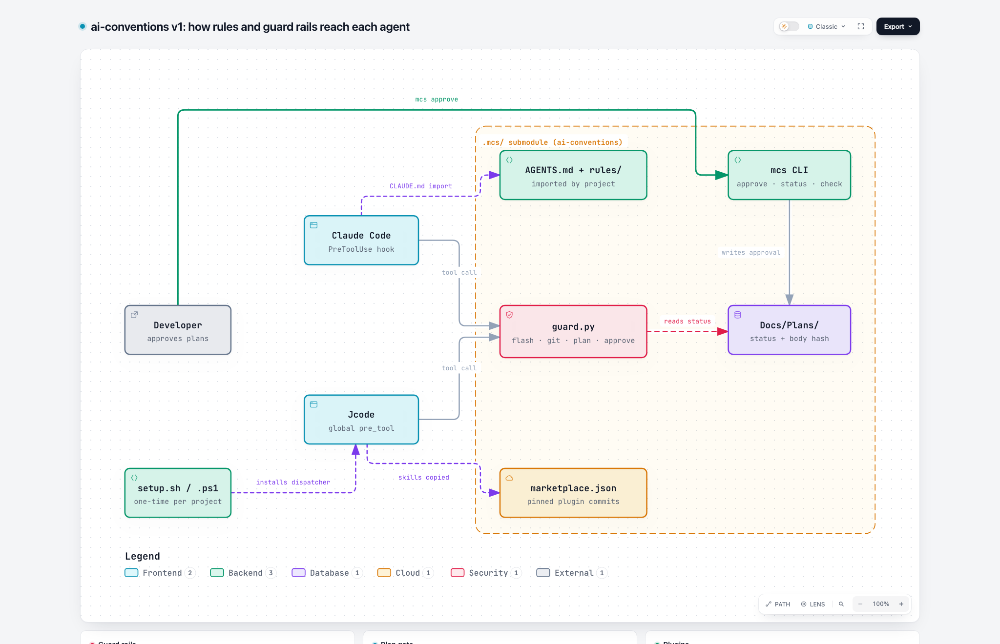
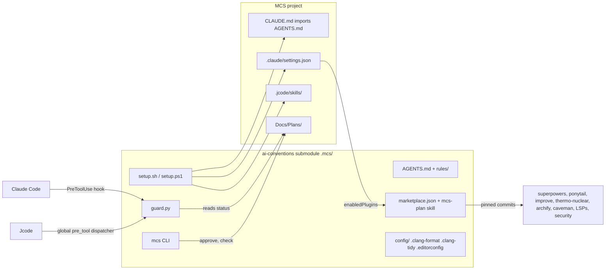

# ai-conventions Implementation Plan

> For agentic workers: implement phase by phase. Each phase ends with a pull
> request; the reviewer is asked per PR. Do not start a phase before the
> previous PR is merged.

**Goal:** One repository, included as a git submodule in every MCS project,
that brings the team's rules, code style, plugins and agent guard rails into
the project with one setup command, for Claude Code and Jcode on macOS and
Windows.

**Architecture:** An agent-neutral core (`AGENTS.md`, rule files, one guard
script) plus one thin adapter per agent. Third-party plugins are referenced
by pinned commit, never copied. Plans are gated: code edits are blocked until
a human approves a plan that contains every mandatory section.

**Tech stack:** Markdown, clang-format, clang-tidy, Python 3 (guard script,
`mcs` CLI, both platforms), Bash and PowerShell (setup only), Claude Code
plugin marketplace format, Jcode `pre_tool` hook.

## Brainstorming

Classification: architectural (new repository, new interfaces used by every
project). Decisions agreed between 2026-10-08 and 2026-10-12:

| Topic | Decision |
|---|---|
| Language | Everything in English: conventions, code, commits, agent rules |
| Scope | Whole company (firmware, Flutter app, data science, backend). Style rules C/C++ only for now |
| Agents, version 1 | Claude Code and Jcode. Codex and Cursor in version 2 |
| Platforms, version 1 | macOS and Windows. A Windows machine is available for testing |
| Protected branches | `main`, `develop`, `release/*`. Every other branch may be pushed |
| Guard rails | Block, never warn |
| Plan first | Rule + `mcs-plan` skill + plan gate |
| Plan approval | Only a human, via `mcs approve <plan>` in their own terminal |
| Mandatory plan sections | Brainstorming, Existing code (improve), Simplification (ponytail), Architecture (archify), Quality review (thermo-nuclear) |
| Plans location | `Docs/Plans/` with an index |
| Reviewer | Asked per pull request, no CODEOWNERS yet |
| Account situation | One shared Claude Max account, no Teams/Enterprise, no Cursor Teams. No managed settings, everything per project |
| Caveman | In the team package, default level below `ultra` |
| Repo name | Rename `fw-ai-conventions` to `ai-conventions` in phase 1 |

C/C++ style (approved 2026-10-08):

- 4 spaces, no tabs; Allman braces everywhere
- Space before `(` in declarations and definitions, none in calls
- Space after `if`, `for`, `while`, `switch`; spaces around binary operators
- Pointer star binds to the name: `int *x`
- Every sub-expression in a condition is parenthesized: `if ((a != b) && (c < MAX))`
- Every loop has a fixed upper bound visible in its condition

| Kind | Style | Example |
|---|---|---|
| Types (class, struct, enum) | PascalCase | `BatteryService` |
| Functions, methods | camelCase | `readState()` |
| Private methods, file-static functions | `_` + camelCase | `_readGauge()` |
| Variables, parameters | lowercase, as short as clear | `soc`, `buf`, `i` |
| Longer variable names | snake_case | `voltage_mv` |
| Private member variables | snake_case + trailing `_` | `last_soc_` |
| Public struct fields | like variables | `voltage_mv` |
| Constants incl. local `const` | UPPER_SNAKE | `MAX_JUMP` |
| Enum values, macros, global objects | UPPER_SNAKE | `READ_FAILED`, `BATTERY_SERVICE` |

A leading underscore is only allowed before a lowercase letter, and only for
private methods and file-static functions.

## Existing code (improve)

Read-only survey on 2026-10-12. What exists and what we do with it:

| Asset | Finding | Decision |
|---|---|---|
| `fw-ai-conventions/CONVENTIONS.md`, `rules/*.md` (uncommitted drafts) | Hard rules, git, agent and documentation rules are valid. Layout rules contradict the approved style (2 spaces, attached braces, `T* x`, `kPascalCase`) | Reuse content, rewrite the style parts |
| `mcs-claude-setup/hooks/selftest.sh` | Table-driven test: pipe JSON into a hook, assert exit code | Reuse the pattern for the guard script tests |
| `mcs-claude-setup/hooks/*.sh` + `*.ps1` | Each hook exists twice (Bash and PowerShell), parsing with `jq`; 286 lines total | Do not repeat: one Python guard instead of two copies per platform |
| `mcs-claude-setup/hooks/CONTRACT.md` | Documents the Claude Code hook input fields the hooks depend on | Reuse the idea: one contract file per agent adapter |
| `FW-Build/Docs/Standards/constitution.md` | No heap after init, no recursion, check return values, short ISRs, agent never flashes | Move into `rules/embedded.md` |
| `FW-Build/Docs/Standards/agent_behavior.md` | Submodules read-only (§7.1), `etl::` over `std::` (§8), relative paths (§6) | Move into `rules/embedded.md` and `rules/agents.md` |
| `FW-Build/Docs/Standards/versioning.md` | Branch model `feature/* -> develop -> release/vX.Y.Z -> main`, `hotfix/*` | Source for the protected branch list |
| `FW-Build/Docker/scripts/entrypoint.sh:102-154` | Injects `team-conventions.md` into `~/.claude/CLAUDE.md` between `MCS-CLAUDE-SETUP` markers | Replaced by the submodule in FW-Build during rollout |
| `FW-Build/Scripts/lib/probe.sh` | Single source for flash/erase: `docker exec debug-tools JLinkExe ... -CommanderScript`, `openocd -s ... -f openocd.tcl` | Flash guard patterns (see Guard rails) |
| `FW-Build/Scripts/flash.sh`, `erase.sh`, `run.sh`, `debug.sh` | Human entry points that drive the probe | Blocked for agents by name |
| `FW-Build/Scripts/dev-env.sh` | Starts the host `JLinkRemoteServer` | Blocked for agents |
| `FW-Build/CMakeLists.txt:253` | `CMAKE_EXPORT_COMPILE_COMMANDS ON` | clangd-lsp works without changes |

## Simplification (ponytail)

Cut from the earlier draft:

1. **One guard script, not four.** The earlier draft had `flash-guard`,
   `push-guard`, `plan-gate`, `approve-guard`. They share input parsing and
   the protected-path logic. Now: `guard.py` with one function per rule and one
   rule table. Fewer files, one test file.
2. **No Bash and PowerShell twins for hooks.** Python 3 runs on both
   platforms. Only setup needs `setup.sh` and `setup.ps1`, because Python may
   not be installed yet when setup starts.
3. **`check.sh` folded into `mcs`.** `mcs check` does what `check.sh` would do,
   on both platforms.
4. **No `CLAUDE.md` in this repo.** The project's `CLAUDE.md` imports
   `.mcs/AGENTS.md` directly.
5. **No `templates/project-AGENTS.md`.** `setup` writes the four import lines
   itself; a template file for four lines is not worth a file.
6. **`rules/` reduced to four files**: `general.md`, `embedded.md`,
   `c-cpp.md`, `agents.md`. `git.md` and `documentation.md` merge into
   `general.md`.
7. **Codex and Cursor adapters, measurement, Dart LSP, InfluxDB/Postgres skills
   moved to version 2.** Not needed to make version 1 useful.

Not cut, on purpose:

- The plan gate. It is the reason this repository exists.
- Windows from the start. Decided by Muri.
- Tests for every guard rule. A guard without a test is a wish.
- Defensive checks in firmware rules are never simplified away.

## Architecture (archify)

Diagram: [`ai-conventions.architecture.html`](ai-conventions.architecture.html)
(interactive, open in a browser)





## Quality review (thermo-nuclear)

Review of the design above, 2026-10-12. Findings and how the plan answers them:

| # | Finding | Resolution |
|---|---|---|
| 1 | Four guard scripts duplicated parsing and path rules ("spaghetti across files") | Merged into one `guard.py` with a rule table (see Simplification) |
| 2 | Per-agent input formats leak into every rule | Each adapter normalizes agent input into one `Call(tool, command, path, cwd)` before rules run. Rules never see agent JSON |
| 3 | Plan gate state hidden in file contents could drift (status edited by hand, plan renamed) | Single source: plan front matter. `mcs approve` writes `approved_by`, `approved_at` and a SHA-256 of the plan body; the gate recomputes it, so an edited approved plan is unapproved again |
| 4 | Jcode dispatcher modifies a global user file; a crash fails open | One machine-wide dispatcher, written only if absent or ours, removed only when no project uses it (R9). `guard.py` uses only the standard library, has a 2 s internal budget under Jcode's 5 s timeout, and logs every internal error for the session-start check (R12) |
| 5 | Regex command matching is bypassable (`bash -c`, aliases, variables) | Accepted and documented: the guard stops accidental actions, not deliberate circumvention. Claude Code additionally gets `permissions.deny` rules |
| 6 | `mcs approve` must not be callable by an agent, but agents can run any shell | `guard.py` blocks any command containing `mcs` followed by `approve` and any write of `status: approved` into `Docs/Plans/`. Approval also requires the user to type the plan name back (see R8) |
| 7 | Third-party plugin updates can silently change behaviour | All entries pinned to a 40-character commit; bumps only by PR |
| 8 | No file in this repo should grow past 1000 lines | `guard.py` is split by rule module if it passes 400 lines |

Independent review on 2026-10-12 (fresh reviewer, no context from the
discussion) found 15 issues, 3 HIGH. All are resolved in this plan:

| # | Sev | Finding | Resolution |
|---|---|---|---|
| R1 | HIGH | Bare `git push` (tracking branch) while on `main` is not caught by branch-name matching | git rule resolves the target at runtime: no refspec means current branch via `git symbolic-ref --short HEAD` and its upstream; `HEAD:x`, `+x`, `refs/heads/x` are normalized before matching |
| R2 | HIGH | CRLF on Windows changes the approval hash, so approved plans look tampered | Hash is computed over the body with line endings normalized to `\n` and trailing whitespace stripped; `.gitattributes` in projects sets `Docs/Plans/*.md text eol=lf` |
| R3 | HIGH | Jcode tool names are lowercase (`bash`, `edit`, `write`, `apply_patch`), Claude Code uses `Bash`, `Edit` | Explicit mapping table in `guard/contract.md` (below); tests feed both spellings |
| R4 | MED | Edits through shell redirection (`echo x > src/a.c`, `sed -i`, `tee`) bypass the plan gate | Shell rule also checks redirections and in-place editors writing to code paths; documented as best effort |
| R5 | MED | Indirect flash (`bash Scripts/flash.sh`, `sh -c "..."`, `make flash`, `cmake --build . --target flash`) | Flash rule matches anywhere in the command string, including after `bash`, `sh -c`, `pwsh -c`, and `flash`/`erase` make or CMake targets |
| R6 | MED | `mcs approve` variants (`python bin/mcs approve`, `.mcs/bin/mcs approve`, `mcs  approve`) | Approve rule matches the token sequence `mcs` followed by `approve` after whitespace normalization, regardless of path prefix |
| R7 | MED | Windows paths (`src\a.c`, `C:\...`) not matched by POSIX path rules | Every path is normalized with `pathlib.PurePath(...).as_posix()` and made relative to the project root before matching |
| R8 | MED | TTY check differs on Windows (PowerShell, ConPTY) | `mcs approve` asks the user to type the plan name back; no reliance on `isatty` alone. Tested in Windows Terminal and PowerShell |
| R9 | MED | Jcode `pre_tool` is one global value; setup in a second project would overwrite the first | Dispatcher is installed once per machine and is project-independent (it locates `.mcs/` from `JCODE_HOOK_CWD`); setup is idempotent and only writes it if absent or ours. Uninstall only removes it when no other project still uses it (`mcs check --machine`) |
| R10 | LOW | `.clang-format` option names: `PointerAlignment: Right` alone leaves references bound to the type | Add `ReferenceAlignment: Right` and `DerivePointerAlignment: false` |
| R11 | LOW | Phase 3 tests do not cover Jcode payload shape | Test rows run once through a Claude Code payload and once through a Jcode payload |
| R12 | LOW | No test that a guard crash is visible (Jcode fails open) | `guard.py` catches every exception, logs to `.mcs/guard.log`, and the session-start check reports recent guard errors |
| R13 | LOW | `Docs/Plans/index.md` can drift from plan files | `mcs status` generates the index; it is not edited by hand |
| R14 | — | Plan gate allows code edits once any plan is approved, even an unrelated one | Accepted for version 1: one active approved plan per branch. `mcs approve` marks older approved plans on the same branch as `superseded` |
| R15 | — | `--force-with-lease` to a personal feature branch is legitimate | Force push is blocked only for protected branches, allowed elsewhere |

## Global constraints

- Python 3.10 or newer for `guard.py` and `mcs`; standard library only.
- No new runtime dependency in projects other than this submodule, Python 3
  and Node.js (archify).
- Every file in this repository below 1000 lines.
- All text in English.
- No AI traces in commits, PR bodies, comments.

## Repository layout (version 1)

```
ai-conventions/
  AGENTS.md                  entry point: hard rules + links to rules/
  rules/
    general.md               plan first, git, PRs, documentation, behaviour
    embedded.md              no heap after init, ETL, ISR, never flash, submodules read-only
    c-cpp.md                 approved C/C++ style
    agents.md                agent behaviour, mandatory plan flow
  config/
    .clang-format
    .clang-tidy
    .editorconfig
  guard/
    guard.py                 one entry point, rule table
    rules_flash.py           flash and probe commands
    rules_git.py             protected branches, force push, self-merge
    rules_plan.py            plan gate, approval protection
    contract.md              normalized Call format, per-agent input mapping
    test_guard.py            table-driven tests, run on macOS and Windows
  adapters/
    claude-code/hooks.json   PreToolUse -> guard.py
    jcode/dispatch.py        global pre_tool -> nearest .mcs/guard/guard.py
  .claude-plugin/
    marketplace.json         mcs-plan plugin + pinned third-party plugins
  plugins/mcs/
    .claude-plugin/plugin.json
    skills/mcs-plan/SKILL.md
    hooks/hooks.json         points at adapters/claude-code
  bin/
    mcs                      Python: approve, status, check
  setup.sh / setup.ps1
  uninstall.sh / uninstall.ps1
  Docs/Plans/index.md
```

## Guard rails

`guard.py` reads one normalized call and exits 0 (allow) or 2 (block, reason
on stderr).

Tool-name mapping in `guard/contract.md` (verified 2026-10-12):

| Normalized | Claude Code `tool_name` | Jcode `JCODE_HOOK_TOOL_NAME` |
|---|---|---|
| shell | `Bash`, `PowerShell` | `bash` |
| edit | `Edit`, `MultiEdit`, `Write`, `NotebookEdit` | `edit`, `write`, `replace`, `apply_patch` |

Unknown tool names are allowed; only mapped tools are checked. Rules:

| Rule | Blocks |
|---|---|
| flash | Anywhere in the command, including after `bash`, `sh -c`, `pwsh -c`: `JLinkExe`, `JLinkGDBServer*`, `JLinkRemoteServer`, `openocd`, `pyocd`, `probe-rs`, `nrfjprog`, `commander flash`, `st-flash`, `docker exec debug-tools`, project scripts `flash.*`, `erase.*`, `run.sh`, `debug.sh`, `dev-env.sh`, and make or CMake targets named `flash` or `erase` |
| git | `git push` whose resolved target (explicit refspec, or current branch and its upstream when none is given) is `main`, `develop` or `release/*`; `--all`, `--mirror`; force push to those branches; `gh pr merge`; `git rebase` while on a protected branch |
| plan | Edit tools writing code files, and shell redirections or in-place editors (`>`, `>>`, `tee`, `sed -i`) targeting code files, while the current branch has no approved plan with a matching normalized body hash. Plans, docs and config stay editable |
| approve | Any command whose tokens contain `mcs` followed by `approve`; any edit that writes `status: approved` into `Docs/Plans/` |

## Distribution

| Agent | How it is wired | One-time user action |
|---|---|---|
| Claude Code | `setup` writes `.claude/settings.json`: `extraKnownMarketplaces` (directory source `.mcs`), `enabledPlugins`, `permissions.deny`, `env.CLAUDE_AUTOCOMPACT_PCT_OVERRIDE=70`. External plugins installed with `claude plugin install <p> --scope project` | trust the folder |
| Jcode | `AGENTS.md` import in project, skills copied to `./.jcode/skills/`, `dispatch.py` set as `[hooks] pre_tool` in `~/.jcode/config.toml` | none |

Jcode also honours `JCODE_HOOK_PRE_TOOL` as an environment variable
(verified live 2026-10-12, see Verification). The config entry stays the
default because it works in every terminal and IDE without shell setup; the
environment variable is used by the tests and for CI.

A session-start hook runs `mcs check` and reports when setup is outdated.

## Team plugin package

All pinned by commit in `.claude-plugin/marketplace.json`.

| Plugin | Source | License | Purpose | Teams |
|---|---|---|---|---|
| mcs (own) | this repo | ours | `mcs-plan` skill, hooks | all |
| superpowers | obra/superpowers | MIT | brainstorming, writing-plans, TDD, debugging | all |
| ponytail | DietrichGebert/ponytail | MIT | simplification review | all |
| improve | shadcn/improve | MIT | read-only codebase survey | all |
| thermo-nuclear | cursor/plugins `cursor-team-kit` | MIT | strict quality review | all |
| archify | tt-a1i/archify `archify/` | MIT | architecture diagrams, mandatory in plans | all |
| caveman | JuliusBrussee/caveman | Apache-2.0 | shorter answers, below `ultra` | all |
| code-review | anthropics/claude-plugins-official | Apache-2.0 | PR review | all |
| claude-security | anthropics/claude-plugins-official | Apache-2.0 | vulnerability scan, on by default | all |
| security-guidance | anthropics/claude-plugins-official | Apache-2.0 | insecure pattern warnings, on by default | all |
| skill-creator | anthropics/claude-plugins-official | Apache-2.0 | build own skills | all |
| hookify | anthropics/claude-plugins-official | Apache-2.0 | build hooks | maintainers |
| clangd-lsp | anthropics/claude-plugins-official | Apache-2.0 | C/C++ | firmware |
| pyright-lsp | anthropics/claude-plugins-official | Apache-2.0 | Python | data science, backend |
| gopls-lsp | anthropics/claude-plugins-official | Apache-2.0 | Go | backend |

Planning flow driven by `mcs-plan`: brainstorming, improve, draft, ponytail,
archify, thermo-nuclear, writing-plans, `mcs approve`. Before a PR:
thermo-nuclear on the diff, then code-review. ponytail runs in planning and
review only, never while writing code.

### Model per step

Cheap models read, strong models judge. Evidence from building this plan:
Haiku readers produced several wrong attributions and unverified claims that
had to be rechecked; the Sonnet review found the three HIGH guard holes.

| Step | Model | Why |
|---|---|---|
| improve survey, file search, log reading, collecting a diff | Haiku | reading and summarizing |
| brainstorming, draft plan, writing-plans | session model (Opus or Sonnet) | design decisions |
| ponytail | session model | judgement on what to cut |
| archify | session model | layout and correctness of the diagram |
| thermo-nuclear on a plan or a diff | Sonnet; Opus for guard, setup or other security-relevant changes | finding non-obvious defects |
| code-review before a PR | Sonnet | |
| implementation | Sonnet | |

Cost rule: reviewers never read the repository themselves. A Haiku agent
first collects the diff, the touched files and the relevant facts into one
summary; the Sonnet or Opus reviewer works only from that summary. `mcs-plan`
states the model for each step.

## Implementation phases (version 1)

### Phase 1: Core

Files: rename repo; create `AGENTS.md`, `rules/general.md`,
`rules/embedded.md`, `rules/c-cpp.md`, `rules/agents.md`; delete
`CONVENTIONS.md`, `rules/cpp-firmware.md`, `rules/git.md`,
`rules/documentation.md` after their content moved.

- [ ] Rename `mcs-datalabs/fw-ai-conventions` to `mcs-datalabs/ai-conventions` on GitHub
- [ ] Write `rules/c-cpp.md` from the approved style in this plan, verbatim tables
- [ ] Move constitution and agent_behavior rules into `rules/embedded.md`, `rules/agents.md`
- [ ] Write `AGENTS.md`: the 8 hard rules, mandatory plan flow, links to `rules/`
- [ ] Check: `grep -rn "T\* \|kPascal\|2 spaces" rules AGENTS.md` returns nothing
- [ ] PR

### Phase 2: Formatting

Files: `config/.clang-format`, `config/.clang-tidy`, `config/.editorconfig`,
`config/test/style_sample.c`, `config/test/style_sample.cpp`.

- [ ] Put the C and C++ example code agreed on 2026-10-08 into `config/test/`
- [ ] Write `.clang-format` (BreakBeforeBraces: Allman, IndentWidth: 4, PointerAlignment: Right, ReferenceAlignment: Right, DerivePointerAlignment: false, SpaceBeforeParens: Custom with AfterFunctionDefinitionName and AfterFunctionDeclarationName true)
- [ ] Run `clang-format --dry-run --Werror config/test/*` : must pass with zero changes
- [ ] Write `.clang-tidy` with `readability-identifier-naming` for every row of the naming table
- [ ] Run `clang-tidy config/test/*` : zero naming warnings; then rename one identifier wrongly and confirm the warning appears
- [ ] PR

### Phase 3: Guard rails

Files: `guard/guard.py`, `guard/rules_*.py`, `guard/contract.md`,
`guard/test_guard.py`.

- [ ] Write `test_guard.py` first: one row per blocked and allowed case from the Guard rails table and from review findings R1 to R7, at least 60 rows, each run once as a Claude Code payload and once as a Jcode payload. Must include: bare `git push` on `main` with upstream, `git push origin HEAD:main`, `git push --force-with-lease origin develop`, force push to a feature branch (allowed), `bash Scripts/flash.sh`, `docker exec debug-tools JLinkExe`, `cmake --build . --target flash`, `python .mcs/bin/mcs approve x`, `echo 1 > src/a.c` without plan, `src\a.c` Windows path, an edit with an approved plan, a tampered approved plan, the same plan with CRLF line endings (still approved)
- [ ] Run tests: all fail
- [ ] Implement `guard.py` and the three rule modules; every exception is caught, logged to `.mcs/guard.log`, and turned into exit 0 so a guard bug never blocks work silently but is reported at session start
- [ ] Run `python -m unittest guard/test_guard.py` on macOS and on Windows: all pass
- [ ] Measure: 100 guard calls average under 100 ms each on both platforms
- [ ] PR

### Phase 4: Adapters

Files: `adapters/claude-code/hooks.json`, `adapters/jcode/dispatch.py`,
`plugins/mcs/hooks/hooks.json`.

- [ ] Claude Code: map `tool_name`, `tool_input.command`, `tool_input.file_path` to `Call`; return `permissionDecision: deny` with reason
- [ ] Jcode: `dispatch.py` reads `JCODE_HOOK_TOOL_NAME` and stdin, walks up from `JCODE_HOOK_CWD` to the nearest `.mcs/guard/guard.py`, exits 0 when none is found
- [ ] Live test in Claude Code and in Jcode: ask the agent to run `git push origin main` and `./Scripts/flash.sh`; both blocked with the guard's reason
- [ ] PR

### Phase 5: `mcs` CLI

Files: `bin/mcs`, `bin/test_mcs.py`.

- [ ] `mcs approve <plan>`: asks the user to type the plan name back (works in Windows Terminal and PowerShell), refuses when a mandatory section is missing or empty, refuses when `Architecture (archify)` links a missing file and does not say `Single component, no diagram:`; writes `approved_by` (git user.name), `approved_at`, `branch`, normalized body hash; marks older approved plans on the same branch `superseded`
- [ ] `mcs status`: lists plans and their state, regenerates `Docs/Plans/index.md`
- [ ] `mcs check`: verifies setup files match the submodule version and reports recent errors from `.mcs/guard.log`; `mcs check --machine` reports which projects use the Jcode dispatcher
- [ ] Tests for each refusal, run on macOS and Windows
- [ ] PR

### Phase 6: Plugin package

Files: `.claude-plugin/marketplace.json`, `plugins/mcs/.claude-plugin/plugin.json`,
`plugins/mcs/skills/mcs-plan/SKILL.md`.

- [ ] Look up the current commit of each third-party plugin and pin it
- [ ] Write `mcs-plan`: the planning flow above, the model per step table, the Haiku-collects / Sonnet-judges rule for reviews; writes the plan file with all mandatory section headers
- [ ] After the archify step, `mcs-plan` opens the diagram in the default browser (`open` on macOS, `start` on Windows), because relative links in the Jcode side panel do not open local HTML files
- [ ] `claude plugin validate .` : passes
- [ ] PR

### Phase 7: Setup, uninstall, rollout

Files: `setup.sh`, `setup.ps1`, `uninstall.sh`, `uninstall.ps1`.

- [ ] Setup: checks Python 3.10+, Node.js, git, clang-format; writes the project files from the Distribution table plus `.gitattributes` line `Docs/Plans/*.md text eol=lf`; copies skills to `.jcode/skills/`; installs the machine-wide Jcode dispatcher only if absent or already ours, and stores any previous foreign `pre_tool` value
- [ ] Uninstall: removes everything setup wrote in the project; removes the dispatcher only when `mcs check --machine` finds no other project using it, then restores the stored `pre_tool`
- [ ] Test in two temporary projects on macOS and Windows: setup both, guard blocks a push to main in both, uninstall one (dispatcher stays), uninstall the other (dispatcher removed, `~/.jcode/config.toml` identical to before), `git status` clean
- [ ] Roll out to a test repository, then FW-Build (replacing the entrypoint injection)
- [ ] PR per repository

## Version 2

- Codex and Cursor adapters, each tested on a real installation
- Measurement of caveman, RTK, Squeez on real tasks; decides the caveman level
- Dart LSP plugin wrapping `dart language-server`
- InfluxDB and Postgres skills
- Style rules for Python, Dart, Go, .proto

## Verification of the plan's load-bearing claims

Throwaway spikes on 2026-10-12, in a scratch directory, nothing committed.
Each row maps a plan requirement to a concrete check and the observed result.

| Requirement / claim | Check | Observed |
|---|---|---|
| Approved C/C++ style is expressible in clang-format (Phase 2) | Ran clang-format 23.1.3 with the Phase 2 options on the agreed C++ example (Allman, 4 spaces, `int *x`, space before `(` in definitions only, `&` on the name) with `--dry-run --Werror` | 0 changes, exit 0 |
| Formatter detects violations | Same options on a file with `int* f(int* x){`, attached braces, one-line `if` | exit 1, 16 violations; formatted output matches the approved style |
| R1: bare `git push` on `main` with upstream is blocked | Spike against a real repo with a bare remote and upstreams on `main` and `feature/x` | blocked; also `git push origin`, `HEAD:main`, `+HEAD:release/1.2`, `feature/x:refs/heads/main`, `--all`, force-with-lease to `develop` blocked |
| R15: pushes and force pushes to a feature branch stay allowed | Same spike on `feature/x` | bare push, `HEAD`, force-with-lease to `feature/x` allowed |
| R2: CRLF does not invalidate approval, edits do | Normalized body hash of an LF plan vs. the same plan in CRLF vs. one changed character | CRLF equal, edit different |
| R7: Windows paths match | `C:\proj\src\a.c` relative to `C:\proj` | `src/a.c` |
| Jcode `pre_tool` can block (Phase 4) | `jcode run` with `JCODE_HOOK_PRE_TOOL` pointing at a hook that exits 2 on a marker command | marker command blocked with the hook's message, next command ran; global config untouched |
| R3: Jcode tool names | Same hook logging `JCODE_HOOK_TOOL_NAME` while the agent wrote and edited a file | `bash`, `write`, `edit`; payload has `command` or `file_path` (relative) |

Not verified yet, covered by the phases: Claude Code hook live test
(Phase 4), Windows runs (Phases 3, 5, 7), clang-tidy naming rules (Phase 2),
setup and uninstall (Phase 7), plugin marketplace validation (Phase 6).

## Open points

- `anthropics/skills` has no license file; nothing taken from it.
- Whether Jcode supports LSP plugins is unverified.
- Whether Jcode also reads `.claude/skills/` is unverified; `.jcode/skills/` is confirmed.
- archify triggers on many topics; watch token cost outside planning.
- The shared Claude Max account is likely against Anthropic's consumer terms;
  decision for management, outside this plan.
